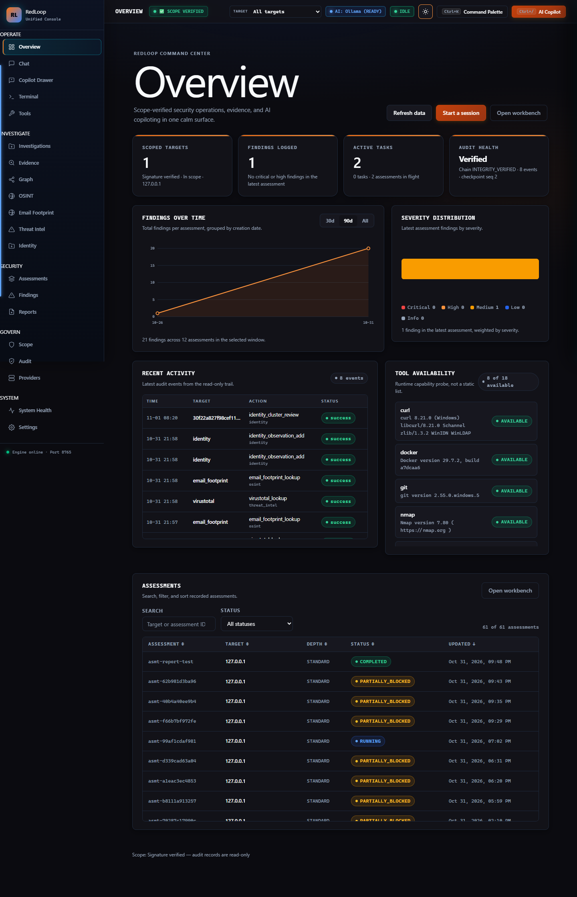
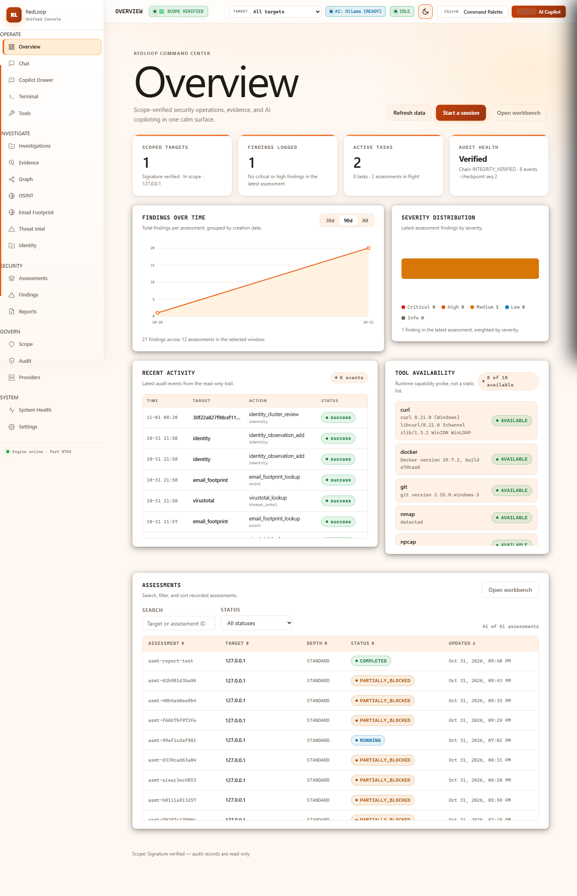
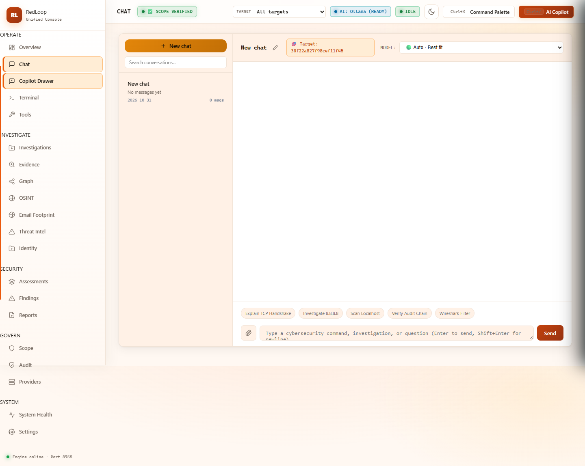
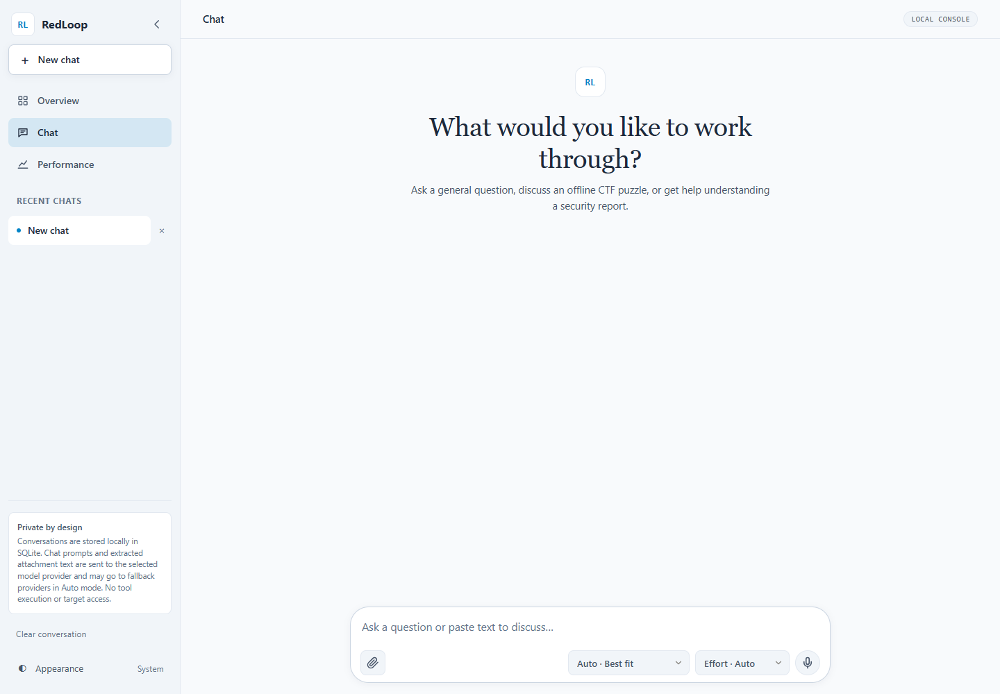
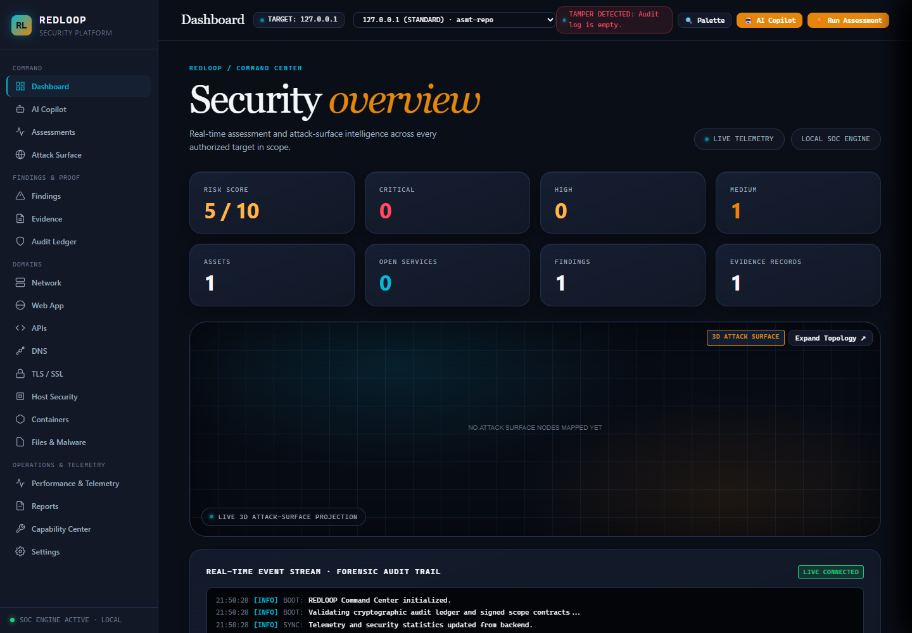
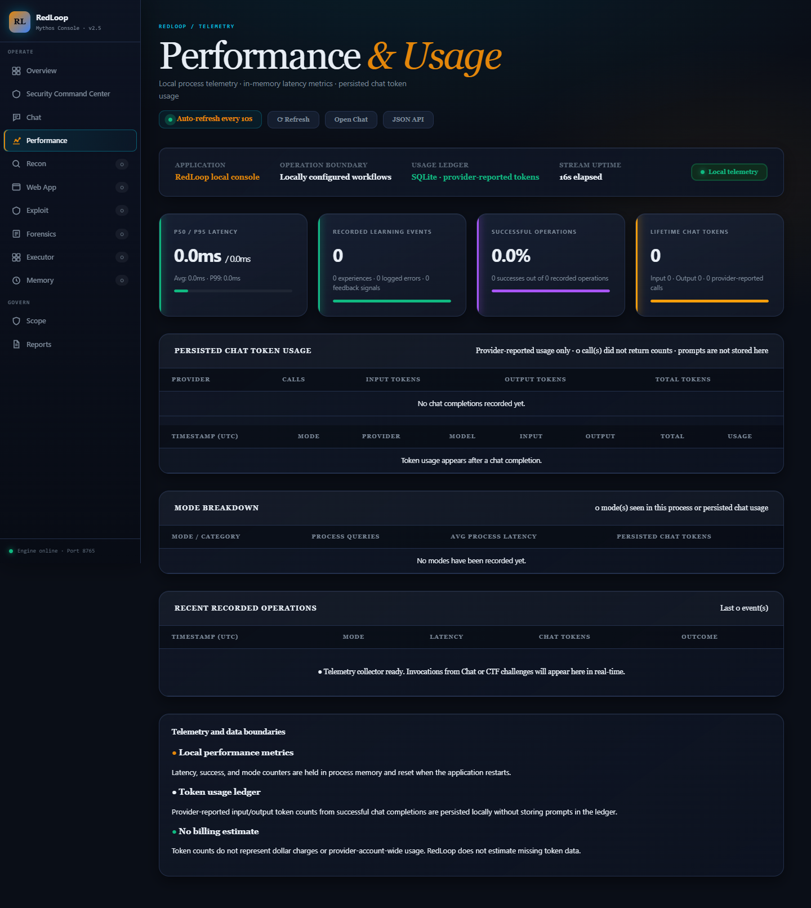
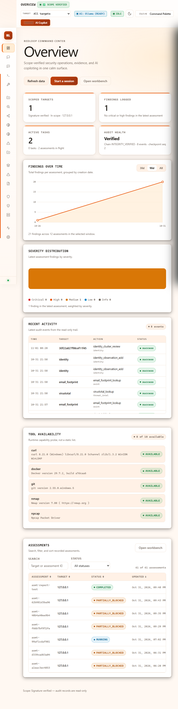
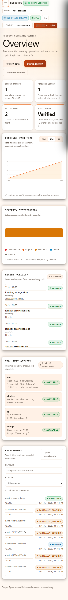
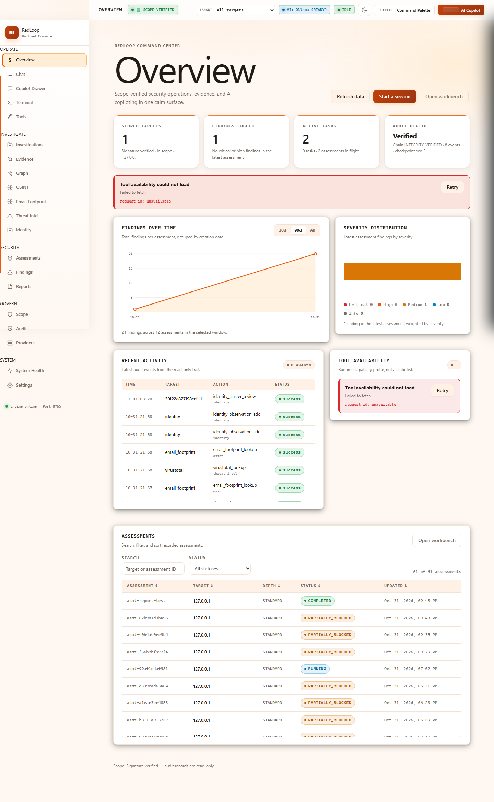
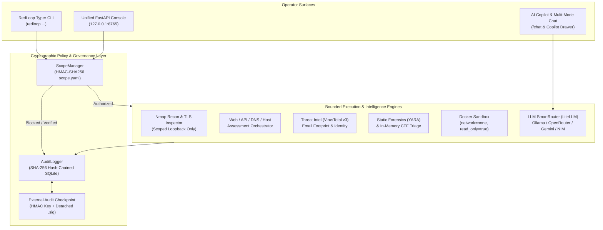

<div align="center">

# 🛡️ RedLoop Cybersecurity Copilot

**Scope-Enforced Autonomous Security Testing, Threat Intelligence & Investigation Workbench**

[](https://www.python.org/)
[](https://fastapi.tiangolo.com/)
[](https://www.docker.com/)
[](#verification--testing)
[](pyproject.toml)

*Locally run, cryptographically scope-limited cybersecurity toolkit and AI copilot for authorized assessments, OSINT & threat intelligence triage, learning labs, and CTFs.*

[Overview](#-overview) •
[Visual Tour](#-visual-tour) •
[Key Capabilities](#-key-capabilities) •
[Architecture](#-architecture) •
[Quickstart](#-quickstart) •
[CLI Reference](#-cli-reference) •
[Security & Scope Boundaries](#-security--scope-boundaries) •
[Verification & Testing](#-verification--testing)

</div>

---

## 🎯 Overview

**RedLoop** combines a **cryptographically enforced scope contract** (`HMAC-SHA256` signed `scope.yaml`), a **tamper-evident SHA-256 hash-chained audit ledger** with external checkpoint anchoring, and a **Unified Security Console** into a single local-first platform.

Unlike unconstrained offensive wrappers, RedLoop enforces **fail-closed policy gates** before any network, recon, or triage operation executes:

- **Cryptographic Scope Verification**: Every target, CIDR, port, and action is validated against an `HMAC-SHA256` signed scope file before execution. Out-of-scope requests fail closed and are recorded in the audit trail.
- **External Audit Checkpoints**: Audit events are chained via `SHA-256` hashes and anchored against an external HMAC checkpoint with detached `.sig` verification to detect ledger truncation, middle-row deletion, or silent tampering.
- **Multi-Provider AI Copilot (`LiteLLM`)**: Seamless routing across local **Ollama** models (default, privacy-first) and optional cloud providers (**OpenRouter, Anthropic, OpenAI, Google Gemini, Groq, NVIDIA NIM, Moonshot Kimi**) with token telemetry and reasoning-effort controls.
- **Verifiable Threat Intel & OSINT**: Live **VirusTotal v3** indicator inspection with canonical SHA-256 evidence sealing, public-source **Email Footprint** reconnaissance, and **Identity Correlation** with analyst review gating.
- **Hardened Execution Sandbox**: Containerized execution enforces `network_mode="none"`, read-only root filesystems, dropped Linux capabilities (`ALL`), and strict resource limits.

---

## 📸 Visual Tour

### Unified Command Center (Dark & Light Themes)

The RedLoop Unified Console (`/`) brings together scoped targets, assessment telemetry, audit chain health, runtime tool availability probes, and recent cryptographic audit events in a calm, high-contrast operational surface.

| Dark Theme (`overview-dark-desktop.png`) | Light Theme (`overview-light-desktop.png`) |
| :---: | :---: |
|  |  |

---

### AI Security Copilot & Multi-Mode Chat

Context-aware cybersecurity copilot supporting **General Security**, **Offline CTF**, and **Report Explainer** workflows, multi-file/folder static attachments, task-heuristic **Auto** routing, and local SQLite conversation persistence.

| Unified Console Chat (`chat-light-desktop.png`) | Standalone Copilot View (`standalone-chat-light.png`) |
| :---: | :---: |
|  |  |

---

### Security Workbench & Performance Telemetry

Execute Red/Blue/Purple track workflows, inspect 3D attack-surface projections and domain findings, and monitor real-time P50/P95 latency alongside provider-reported token ledgers.

| Security Workbench (`workbench-dark-desktop.png`) | Performance & Usage Telemetry (`performance-dark-desktop.png`) |
| :---: | :---: |
|  |  |

---

### Responsive Tablet & Mobile Views

Designed for clarity across viewports, with collapsible navigation drawers and fault-tolerant error states.

| Tablet Layout (`overview-light-tablet.png`) | Mobile Layout (`overview-light-mobile.png`) | Resilient Error State (`overview-light-error.png`) |
| :---: | :---: | :---: |
|  |  |  |

---

## ⚡ Key Capabilities

### 1. Governed Security Operations & Assessment Engine
- **Loopback Recon & Service Profiling**: Explicit-port Nmap service detection with a 4-step bounded reliability ladder. Fails closed if Nmap scan metadata does not match requested scoped ports.
- **Web & API Metadata Inspection**: Single-request root HTTP header analysis, missing security header detection (`CSP`, `HSTS`, `X-Frame-Options`), cookie flag verification, and technology disclosure checks.
- **TLS / Certificate Inspection**: Real certificate chain inspection, expiration window checks, SAN verification, self-signed detection, and weak cipher/protocol identification.
- **Modular Assessment Orchestrator**: Deep assessment pipelines across Network, Web, API, DNS (`SPF`/`DKIM`/`DMARC`), TLS, Host, Container/Dockerfile, and Software dependencies mapped to **OWASP ASVS**.

### 2. Threat Intelligence, OSINT & Identity Correlation
- **VirusTotal v3 Integration (`src/redloop/virustotal.py`)**:
  - Inspects IPs, domains, URLs, and file hashes (`MD5`, `SHA-1`, `SHA-256`) with strict indicator-type validation.
  - Computes canonical `SHA-256` evidence hashes, tracks `observed_at` vs. `fetched_at` timestamps, isolates cached responses via deep copy, and never labels zero detections as "safe."
- **Public-Source Email Footprint (`src/redloop/email_footprint.py`)**:
  - Deterministic offline syntax/domain checks plus opt-in public-source adapters (MX/SPF/DMARC, Gravatar avatar hash lookup, public commit exposure, redacted breach metadata).
  - Strictly prohibits account-enumeration probes, login attempts, or password-reset triggers.
- **Identity Correlation & Review Gating (`src/redloop/identity_correlation.py`)**:
  - Clusters public observations and enforces **Analyst Review Gating**: weak identifiers (such as usernames or avatars alone) cannot auto-confirm an identity cluster without a confirming identifier or explicit analyst sign-off.

### 3. Static Forensics & Offline CTF Triage
- **Bounded Static File Forensics**: Computes cryptographic hashes, signature-based file types, Shannon entropy, printable IOC strings, and optional local **YARA** rule matches (capped at `16 MiB`, zero sample execution).
- **In-Memory CTF Archive Analyzer**: Inspects ZIP archives entirely in memory with strict caps on archive size, member count, nested depth, and decoding strategies to prevent zip-bomb exhaustion.

### 4. Tamper-Evident Audit Ledger & Checkpoints
- **Hash-Chained SQLite Ledger (`src/redloop/audit.py`)**: Every allowed or blocked action records an immutable chain link (`prev_hash` $\rightarrow$ `entry_hash`) with automatic secret redaction.
- **External Checkpoint Anchoring (`src/redloop/audit_checkpoint.py`)**: Anchors the ledger sequence and tip hash to an external checkpoint file signed with a dedicated 32-byte key and `.sig` sidecar, detecting database replacement, row modification, or tail rollback.

---

## 🏗️ Architecture



### Capability & Enforcement Matrix

| Module / Work Area | Capability | Pipeline Enforcement | Status |
| :--- | :--- | :--- | :---: |
| **Unified Console** | Command Center, Workbench, Copilot Drawer, Telemetry, Theme Engine | Loopback-bound (`127.0.0.1`), CSP script hashing | **Implemented** |
| **Scope Governance** | `HMAC-SHA256` signed target/CIDR/port/time-window contracts | `ScopeManager.check()` fail-closed gate | **Implemented** |
| **Audit & Checkpoints** | `SHA-256` hash chain + external `HMAC` checkpoint & `.sig` sidecar | `AuditLogger` + `ExternalCheckpointManager` | **Implemented** |
| **Threat Intel (VT)** | Live VirusTotal v3 IP, domain, URL, hash lookup + canonical sealing | Type validation + `SHA-256` evidence hash | **Implemented** |
| **Email Footprint** | Public-source email OSINT (DNS, Gravatar, commits, breach count) | Public-source boundary + opt-in live lookup | **Implemented** |
| **Identity Correlation** | Entity clustering with weak-identifier gating & analyst review | Confirming-identifier & review state machine | **Implemented** |
| **Reconnaissance** | Explicit-port Nmap service profiling with 4-step reliability ladder | `ScopeManager.check(target, "recon", port)` | **Implemented** |
| **TLS / Certificate** | Cert chain, expiry, SAN, self-signed, weak cipher & protocol checks | `ScopeManager.check(target, "tls_check", port)` | **Implemented** |
| **Web App Inspector** | Root HTTP metadata, security headers, cookie flags | `ScopeManager.check(target, "web_test", port)` | **Implemented** |
| **Docker Sandbox** | Isolated container execution (`network="none"`, dropped caps) | `ScopeManager` + strict Docker config | **Implemented** |
| **Static Forensics** | `16 MiB` bounded file triage, Shannon entropy, IOCs, YARA rules | Static in-memory read, secret redaction | **Implemented** |
| **CTF Triage** | Offline workflow simulator & bounded in-memory ZIP flag hunter | Byte/depth/member caps, zero extraction | **Implemented** |
| **Episodic Memory** | Local bounded lexical recall in SQLite (`10,000` cap) | Advisory only, never bypasses scope | **Implemented** |

---

## 🚀 Quickstart

### 1. Installation

```bash
# Clone the repository
git clone https://github.com/rabigupta-123/redloop-cybersecurity-copilot.git
cd redloop-cybersecurity-copilot

# Install core CLI + Unified Console dashboard + Recon & Forensics extras
pip install -e ".[dashboard,recon,forensics,dev]"
```

### 2. Configure Environment & Sign Scope

```bash
# Copy example environment and scope files
cp .env.example .env
cp scope.yaml.example scope.yaml

# Sign your scope.yaml with HMAC-SHA256
redloop scope init --in scope.yaml --out scope.yaml

# Verify target authorization against signed scope
redloop scope check 127.0.0.1 recon
```

### 3. Launch the Unified Security Console

```bash
# Start the local FastAPI Unified Console & Workbench on http://127.0.0.1:8765
redloop report serve --port 8765
```

Open **`http://127.0.0.1:8765`** in your browser to access:
- **`/`** — Unified Command Center (Overview, Investigations, Evidence, Graph, OSINT, Email Footprint, Threat Intel, Identity, Assessments, Scope, Audit, Providers)
- **`/workbench`** — Red / Blue / Purple Track Security Workbench & 3D Attack Surface
- **`/chat`** — Standalone Multi-Provider AI Security Copilot
- **`/performance`** — Real-Time Latency & Token Usage Telemetry

---

## 💻 CLI Reference

| Command | Description |
| :--- | :--- |
| `redloop scope init --in scope.yaml --out scope.yaml` | Sign a `scope.yaml` contract with `HMAC-SHA256` |
| `redloop scope check <target> <action>` | Verify target & action authorization against signed scope |
| `redloop report serve [--port 8765]` | Launch the local Unified Console, Workbench, and Copilot |
| `redloop report targets` | List all audited targets in the local SQLite ledger |
| `redloop report generate <target> [--output <path>]` | Generate a Markdown security report from audit rows |
| `redloop recon scan <target> --port <port> [...]` | Scan explicit ports on a scoped loopback target |
| `redloop recon profile <target> [--port <port> ...]` | Profile scoped ports using Nmap service detection |
| `redloop tls check <target> [--port <port>]` | Inspect TLS certificate chain, expiry, SANs, and weak ciphers |
| `redloop web inspect <url>` | Inspect HTTP security headers and cookie flags on loopback |
| `redloop forensics analyze <file> [--rules-dir <dir>]` | Run bounded (`16 MiB`) static file triage and YARA matching |
| `redloop ctf list` / `redloop ctf show <id>` | Browse offline synthetic CTF workflow challenges |
| `redloop ctf simulate <id> --module <name> [--confirm]` | Simulate confirmation/job/session flow offline |
| `redloop ctf solve-file <archive.zip> [--flag-prefix ...]` | Hunt for flags in a local ZIP archive entirely in memory |
| `redloop memory recall <task> [--module <name>]` | Query local episodic memory using lexical similarity |
| `redloop sandbox build` / `redloop sandbox run` | Build and smoke-test the network-isolated Docker sandbox |
| `redloop llm test` / `redloop llm-bench` | Verify LLM connectivity and benchmark provider latency |
| `redloop agent run <task> --target <target>` | Run a bounded, local-only operation through the executor |

### Example `scope.yaml` Contract

```yaml
version: 1
id: "lab-2026-q4"
authorized_by: "security-lead"
signed_at: "2026-10-21T00:00:00Z"
expires_at: "2026-12-31T23:59:59Z"
targets:
  - cidr: "127.0.0.1/32"
    label: "local-loopback-lab"
    authorized_from: "2026-10-01"
    authorized_until: "2026-12-31"
    ports: [8080, 8081, 8082, 8765]
    allowed_actions:
      - "recon"
      - "web_test"
      - "tls_check"
      - "assess"
notes: "Authorized local testing only."
signature: "<hmac-sha256-signature>"
```

---

## 🔒 Security & Scope Boundaries

RedLoop is architected with explicit, verifiable operational boundaries:

1. **Loopback & Signed-Scope Enforcement**:
   - Recon (`nmap`) and web inspection accept only literal loopback IP addresses with every port explicitly authorized in the verified `scope.yaml`.
   - Nmap's own XML/scan metadata must confirm all requested ports, or the check fails closed.
2. **No Arbitrary Model-Generated Code Execution**:
   - The local executor selects only from a fixed catalog of validated internal operations; unknown operations are rejected.
   - The Docker sandbox enforces `network_mode="none"`, rejects custom bridge networks and caller-supplied environment variables, mounts root read-only, and drops all Linux capabilities.
3. **Public-Source OSINT & Evidence Integrity**:
   - **VirusTotal**: Validates declared indicator type against detected format, seals responses with a canonical `SHA-256` hash, and never extrapolates "0 malicious detections" into a claim of safety.
   - **Email Footprint**: Uses only passive/public metadata adapters; never triggers password resets or login enumeration.
   - **Identity Correlation**: Requires a confirming identifier or explicit analyst review to transition from `UNVERIFIED` to `CONFIRMED_PUBLIC_ASSOCIATION`.
4. **Data & Telemetry Privacy**:
   - Cloud LLM routing is **disabled by default** (`ALLOW_CLOUD_ROUTING=false`) so local prompts stay on local Ollama unless explicitly enabled.
   - The token usage ledger stores only timestamps, mode, provider/model identifiers, and token counts—never prompts or file attachments.

---

## ✅ Verification & Testing

RedLoop includes an extensive automated test suite covering unit, security regression, UI/runtime, and live local integration checks (**559 tests passing**):

```bash
# Run the complete verification suite (559 tests)
python -m pytest -q -p no:cacheprovider

# Run focused security & feature regression suites
python -m pytest -q \
  tests/test_virustotal.py \
  tests/test_email_footprint.py \
  tests/test_identity_correlation.py \
  tests/test_audit_checkpoint.py \
  tests/test_visual_redesign.py \
  tests/test_workbench_new_features.py \
  tests/test_scope.py \
  tests/test_sandbox.py
```

### Test Coverage Highlights
- **Scope & Policy Hardening**: Fail-closed target/port rejection, expired scope handling, HMAC signature tamper detection (`tests/test_scope.py`, `tests/test_pipeline_hardening.py`).
- **Docker Sandbox Invariants**: Forced `network="none"`, host/env injection rejection, timeout termination, container cleanup (`tests/test_sandbox.py`).
- **Threat Intel & OSINT Integrity**: VirusTotal canonical hash verification & cache isolation (`35 tests`), Email Footprint public boundaries (`14 tests`), Identity Correlation review gating (`13 tests`).
- **Audit & Checkpoint Tamper Resistance**: Middle-event deletion, payload modification, key rotation, and detached `.sig` verification (`14 tests` in `tests/test_audit_checkpoint.py` + `tests/test_audit_verify.py`).

---

## 📂 Repository Structure

```text
redloop-cybersecurity-copilot/
├── artifacts/ui/              # High-resolution UI screenshots (Dark/Light, Desktop/Tablet/Mobile)
├── core/                      # Core routing helpers
├── docs/                      # Architecture & confidence scoring documentation
├── modules/ctf/               # Offline CTF orchestration & flag detection strategies
├── scripts/                   # Contrast & live endpoint verification scripts
├── self-learning-agent/       # Optional self-learning prototype package & tests
├── services/learning_service/ # Optional FastAPI learning microservice
├── src/redloop/               # Primary RedLoop package
│   ├── assessment/            # Modular assessment engines (Web, API, DNS, TLS, Host, Kali Copilot)
│   ├── audit.py               # SHA-256 hash-chained SQLite audit logger
│   ├── audit_checkpoint.py    # External HMAC checkpoint & detached signature verifier
│   ├── chat.py                # Multi-provider AI Copilot & conversation store
│   ├── cli.py                 # Typer CLI entrypoint
│   ├── dashboard.py           # Local FastAPI dashboard routes
│   ├── email_footprint.py     # Public-source email OSINT engine
│   ├── forensics.py           # Bounded static file triage & YARA scanner
│   ├── identity_correlation.py# Identity clustering & analyst review gating
│   ├── investigation_graph.py # Entity & evidence graph builder
│   ├── llm.py                 # LiteLLM client & SmartRouter
│   ├── recon.py               # Scoped Nmap service profiler
│   ├── sandbox.py             # Hardened network-none Docker sandbox
│   ├── scope.py               # HMAC-SHA256 scope manager
│   ├── tls.py                 # TLS certificate & cipher inspector
│   ├── unified_app.py         # Unified Command Center frontend & API
│   ├── virustotal.py          # VirusTotal v3 client with canonical evidence sealing
│   └── workbench.py           # Red/Blue/Purple Security Workbench
├── tests/                     # 559 automated unit, integration, and security regression tests
├── .env.example               # Template environment configuration (no secrets)
├── pyproject.toml             # Package metadata & optional dependency groups
└── scope.yaml.example         # Example scope contract template
```

---

## 📄 License

Released under the **MIT License**. Intended strictly for **authorized security assessments, defensive engineering, research labs, and educational CTF environments**.
