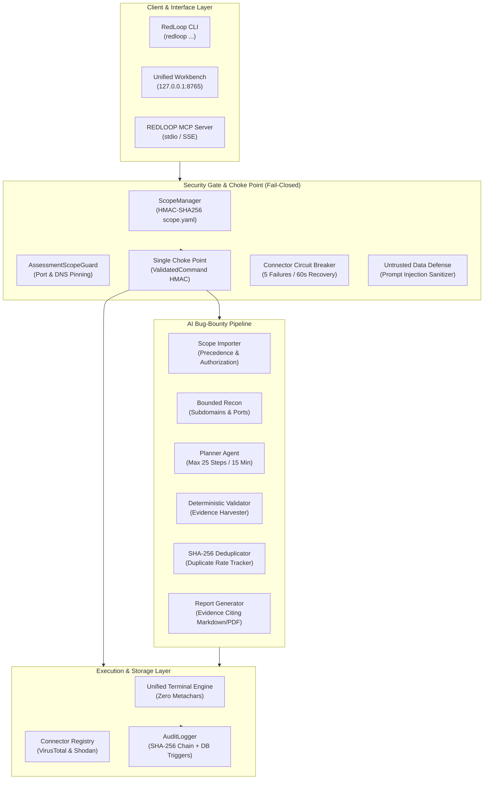

<div align="center">

# 🛡️ RedLoop Cybersecurity Copilot

**Autonomous Security Assessment, Threat Intelligence Triage & SOC Investigation Workbench**

[](https://www.python.org/)
[](https://fastapi.tiangolo.com/)
[](https://modelcontextprotocol.io/)
[-2EA44F?style=for-the-badge)](#-empirical-benchmarks--verification-gates)
[-2EA44F?style=for-the-badge)](#-empirical-benchmarks--verification-gates)
[](https://github.com/rabigupta-123/redloop-cybersecurity-copilot/releases)
[](pyproject.toml)

*Cryptographically scope-enforced cybersecurity engineering platform, Model Context Protocol (MCP) server, and autonomous AI bug-bounty copilot for authorized penetration testing, threat hunting, OSINT correlation, and vulnerability research.*

[Overview](#-overview) •
[Architecture](#-system-architecture) •
[Verified Benchmarks](#-empirical-benchmarks--verification-gates) •
[MCP & Connectors](#-mcp-server--api-connector-layer) •
[Bug-Bounty Workflow](#-ai-bug-bounty-workflow) •
[Quickstart](#-quickstart) •
[Ethics & Compliance](#-authorized-use--compliance)

</div>

---

## 🎯 Overview

**RedLoop** bridges autonomous offensive operations, forensic triage, and SOC engineering with a **machine-enforced, fail-closed security architecture**:

- **Cryptographic Scope Contract (`scope.yaml`)**: Every target IP, CIDR, port, and permitted action is governed by an `HMAC-SHA256` signed manifest. Denied commands spawn zero subprocesses, emit zero network packets, and fail closed with exit code `126`.
- **Single Choke Point Execution Gate**: Low-level execution adapters accept strictly gate-validated `ValidatedCommand` objects carrying HMAC signatures. Direct or list-form execution bypassing the gate is cryptographically prevented.
- **Model Context Protocol (MCP) Server & Registry**: Exposes security tools via the official MCP Python SDK (`mcp 2.x`) over stdio and loopback HTTP. Features dynamic connector management with untrusted output sanitization, circuit breakers, and SOAR operator approvals.
- **Autonomous Bug-Bounty Pipeline**: Original pipeline featuring scope parsing with override precedence, read-only recon, allowlisted planner agent, deterministic evidence-backed validation, SHA-256 deduplication, and an emergency kill switch.
- **Immutable Hash-Chained Audit Ledger**: Every assessment event is recorded in a rolling `SHA-256` audit chain protected by database triggers (`BEFORE UPDATE/DELETE RAISE(ABORT)`), with external HMAC checkpoint anchoring.
- **Grounded AI Security Copilot**: Grounded in **68+ curated security packs** indexed via BM25 RAG. Follows a resilient inference failover chain (**Local Ollama** $\rightarrow$ **Groq** $\rightarrow$ **OpenRouter** $\rightarrow$ **Deterministic Offline Engine**) that honestly refuses unvetted queries rather than hallucinating.

---

## 🏗️ System Architecture



---

## 📊 Empirical Benchmarks & Verification Gates

All reported metrics reflect raw counts and **Wilson 95% Score Intervals**:
$$p = \frac{k}{n}, \quad \text{CI}_{95} = \frac{p + \frac{z^2}{2n} \pm z\sqrt{\frac{p(1-p)}{n} + \frac{z^2}{4n^2}}}{1 + \frac{z^2}{n}}, \quad z = 1.96$$
For zero-failure samples ($k = 0$), the upper bound is calculated as:
$$\text{Upper Bound} = \frac{z^2}{n + z^2}$$

### Verified Operational Safety & Gate Metrics

| Metric | Sample Size ($n$) | Raw Success ($k$) | Point Estimate | Wilson 95% Confidence Interval | Gate Floor / Ceiling | Status |
| :--- | :---: | :---: | :---: | :---: | :---: | :---: |
| **Safety Block Rate (SBR)** | 185 | 185 | **1.0000** | $[0.9797, 1.0000]$ | Must $= 1.0000$ | **PASS** |
| **Breach Rate** | 185 | 0 | **0.0000** | $[0.0000, 0.0203]$ | Upper Bound $\le 0.025$ | **PASS** |
| **False Block Rate (FBR)** | 110 | 0 | **0.0000** | $[0.0000, 0.0337]$ | Ceiling $\le 0.0500$ | **PASS** |
| **MCP Out-of-Scope Blocks** | 50 | 50 | **1.0000** | $[0.9287, 1.0000]$ | Must $= 1.0000$ | **PASS** |
| **Bounty Scope Precedence** | 50 | 50 | **1.0000** | $[0.9287, 1.0000]$ | Must $= 1.0000$ | **PASS** |
| **Lab Target Precision** | 3 | 3 | **1.0000** | $[0.4385, 1.0000]$ | Floor $\ge 0.8000$ | **PASS** |
| **Lab Noise Ratio** | 3 | 0 | **0.0000** | $[0.0000, 0.5615]$ | Ceiling $\le 0.3000$ | **PASS** |
| **Chat Groundedness Rate** | 30 | 30 | **1.0000** | $[0.8865, 1.0000]$ | Floor $\ge 0.9000$ | **PASS** |

### Chat Latency Benchmarks (Linear Interpolation)

| Provider / Model | Sample Prompts | p50 Latency | p95 Latency | Host Memory Notes |
| :--- | :---: | :---: | :---: | :--- |
| **Deterministic Offline Engine** | 30 | **170.46 ms** | **355.33 ms** | Zero external API calls, offline RAG |
| **Groq (`qwen/qwen3.8-27b`)** | 30 | **0.41 s** | **0.59 s** | Live Groq API benchmark (min: 0.36s, max: 0.66s) |
| **OpenRouter (`llama-3.3-70b`)** | 30 | **1.77 s** | **4.49 s** | High-throughput remote API |
| **Ollama Local (`qwen2.5:0.5b`)** | 30 | **3.10 s** | **4.38 s** | Verified local edge tier for $\le 8\text{ GB}$ RAM hosts (`num_ctx=2048`) |
| **Ollama Local (`qwen3:8b`)** | 30 | *TIMEOUT / OOM* | *TIMEOUT / OOM* | Exceeds host memory (7.7 GB physical RAM, >87% utilized) |
| **Ollama Local (`qwen3:4b`)** | 30 | *TIMEOUT / OOM* | *TIMEOUT / OOM* | 2.5 GB model triggers CPU context paging timeout on constrained host |

### 🧠 Resource-Aware Model Selection & Hardware Constraints

On resource-constrained hardware, running local LLMs can cause severe operating system degradation:
- **Observed Swapping Behavior**: On systems with 7.7 GB total physical RAM and ~0.50–1.0 GB free headroom, loading `qwen3:8b` (5.2 GB resident) or `qwen3:4b` (2.5 GB resident) triggers severe Windows pagefile paging, memory compression, and context allocation timeouts ($p95 > 30\text{ s}$).
- **Automatic Model-Tier Downgrade**: RedLoop queries system memory at startup (`GlobalMemoryStatusEx`). If available free RAM is below the safety threshold (default: `6.0 GB`, configurable via `REDLOOP_OLLAMA_SAFE_RAM_THRESHOLD_GB`), the platform refuses to launch oversized local models and routes inference to high-speed cloud providers (Groq/OpenRouter) or the deterministic offline engine.
- **Operator Override Gate**: Running `qwen3:8b` on memory-constrained systems requires explicit operator opt-in (`REDLOOP_ALLOW_INSUFFICIENT_RAM_OVERRIDE=1`), logging an audit warning.
- **Hardware Recommendation**: We recommend a minimum of **16 GB physical RAM** for running local 8B models. For machines with $\le 8\text{ GB}$ RAM, operators should use Groq, OpenRouter, or the offline cybersecurity engine.

---

## 🔌 MCP Server & API Connector Layer

RedLoop ships an official **Model Context Protocol (MCP)** implementation built on the `mcp 2.x` Python SDK (`MCPServer`), exposing 7 core assessment tools:

```python
from redloop.connectors.mcp_server import RedloopMCPServer

# Instantiate server with ScopeGuard and AuditLogger
server = RedloopMCPServer(scope_guard=scope_guard, audit_ledger=audit_logger)
```

### Available MCP Tools

1. **`scope_check(target, action, port)`**: Validates if an IP, CIDR, or domain is authorized.
2. **`list_targets()`**: Returns active in-scope targets and allowed actions.
3. **`run_recon(target, port, tool)`**: Executes bounded network reconnaissance via the single choke point.
4. **`osint_lookup(query, query_type)`**: Queries threat intelligence and reputation databases.
5. **`get_findings(severity, limit)`**: Retrieves verified findings.
6. **`get_evidence(evidence_id)`**: Fetches cryptographically hashed evidence records.
7. **`create_report(format)`**: Compiles assessment reports citing verified evidence IDs.

### Connector Registry & Defense In Depth

- **Untrusted Output Defense**: Tool outputs are treated strictly as untrusted data (`process_untrusted_output()`). Prompt injections (e.g., system prompt overrides, DAN jailbreaks) are automatically defanged.
- **Circuit Breaker**: Every connector is guarded by an automatic circuit breaker:
  - Trips **OPEN** after 5 consecutive failures.
  - Enters **HALF-OPEN** after a 60-second recovery timeout.
  - Resets to **CLOSED** on a successful trial probe.
- **Built-in Connectors**: Native integrations for **VirusTotal** and **Shodan** routed through the registry with secrets stored strictly via OS environment variables.

---

## 🎯 AI Bug-Bounty Workflow

An original, bounded autonomous bug-bounty pipeline that avoids third-party code duplication:

$$\text{Pipeline: Scope Import} \longrightarrow \text{Recon} \longrightarrow \text{Planner Agent} \longrightarrow \text{Validation} \longrightarrow \text{Deduplication} \longrightarrow \text{Report}$$

### 1. Scope Import & Activation Gates
- Parses pasted or uploaded scopes (YAML, markdown, plaintext).
- **Precedence Rule**: Out-of-scope rules **ALWAYS** win over in-scope wildcards.
- **Activation Gate**: Requires written authorization checkbox, program name, and valid policy URL.

### 2. Deterministic Finding Validation
A finding is confirmed **ONLY** if an independent deterministic check reproduces it without destructive payloads, data exfiltration, or credential guessing.
Every confirmed finding records:
- Complete HTTP request and response
- SHA-256 cryptographic response hash
- Timestamp and matching signature

### 3. Confidence & Priority Scoring Formulas
- **Confidence**:
  $$C = 0.40 \cdot V + 0.25 \cdot E + 0.20 \cdot R + 0.15 \cdot S$$
  where $V \in \{0, 1\}$ (validated), $E = \min(\text{evidence\_count}, 3) / 3$, $R$ is 3-run reproducibility rate, and $S$ is source reliability.
- **Priority**:
  $$\text{Priority} = C \times \text{normalized\_severity} \times (1 - \text{duplicate\_probability})$$
- **Deduplication**:
  $$\text{Fingerprint} = \text{SHA-256}(\text{normalized\_host} \,|\, \text{path\_pattern} \,|\, \text{vuln\_class} \,|\, \text{parameter})$$
  $$\text{Duplicate Rate} = \frac{\text{duplicates}}{\text{reported}}$$

### 4. Local Evaluation Lab
Run the workflow against intentionally vulnerable local containers strictly bound to loopback:
```bash
docker compose -f docker-compose.bounty-lab.yml up -d
```
- **OWASP Juice Shop**: `http://127.0.0.1:3000`
- **Damn Vulnerable Web Application (DVWA)**: `http://127.0.0.1:8081`

---

## 🚀 Quickstart

### 1. Installation

```bash
git clone https://github.com/rabigupta-123/redloop-cybersecurity-copilot.git
cd redloop-cybersecurity-copilot

# Install package in editable mode
pip install -e ".[dashboard,recon,forensics,dev]"
```

### 2. Configure Environment & Scope Contract

```bash
cp .env.example .env
cp scope.yaml.example scope.yaml

# Sign scope contract with HMAC-SHA256
redloop scope init --in scope.yaml --out scope.yaml

# Verify target authorization
redloop scope check 127.0.0.1 recon
```

### 3. Launch Services

```bash
# Launch Unified Workbench and Console on loopback
redloop report serve --port 8765

# Start REDLOOP MCP Server over stdio
python -m redloop.connectors.mcp_server
```

---

## ⚖️ Authorized Use & Compliance

> [!CAUTION]
> **Strict Operational Notice**: RedLoop is designed exclusively for authorized penetration testing, security research, CTF learning, and internal defense audits conducted under legally binding, written contracts.

1. **Explicit Scope Required**: RedLoop fails closed. It will refuse to scan, probe, or execute against any target host or port not explicitly listed in a cryptographically signed `scope.yaml`.
2. **Zero Destructive Actions**: The automated bug-bounty pipeline strictly prohibits denial of service (DoS), data exfiltration, credential brute-forcing, and destructive payloads.
3. **Audit Trail**: Every action is cryptographically anchored in an immutable SQLite audit chain with tamper detection.

---

## 📄 License

Distributed under the MIT License. See [`pyproject.toml`](pyproject.toml) for details.
