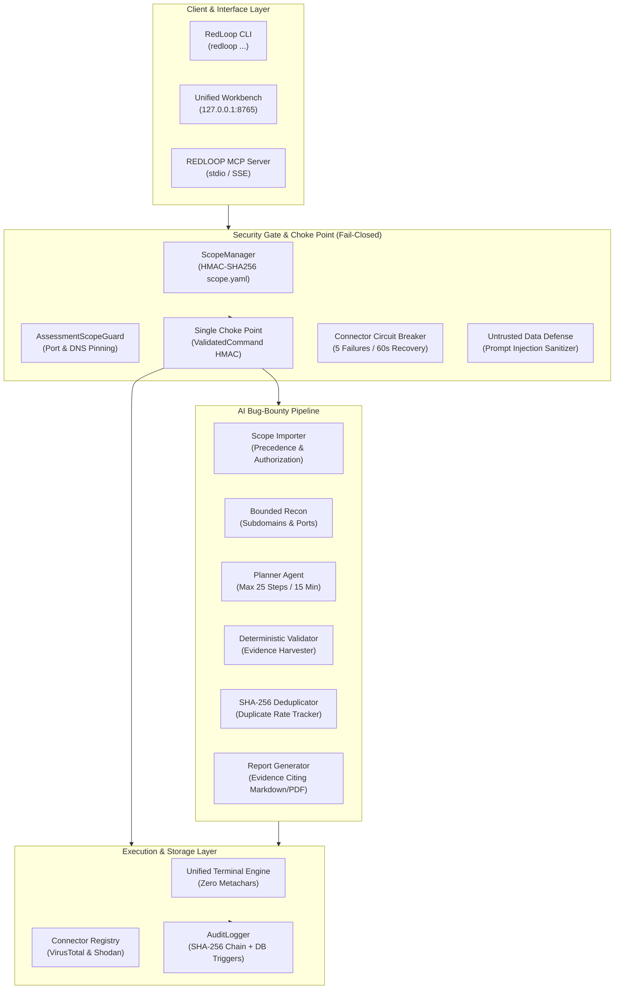
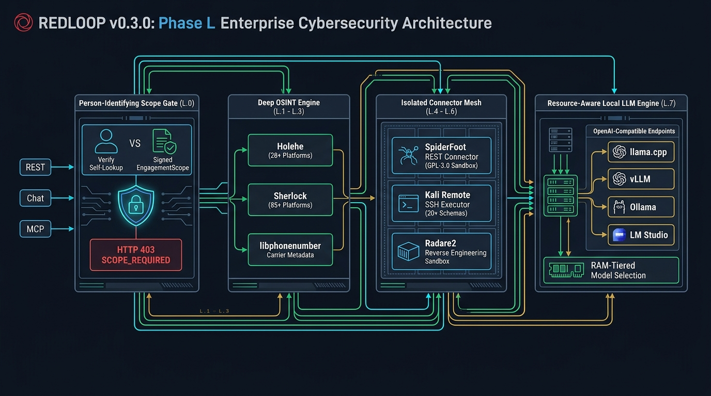
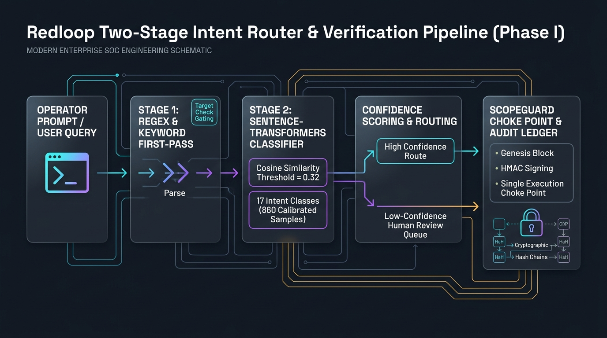
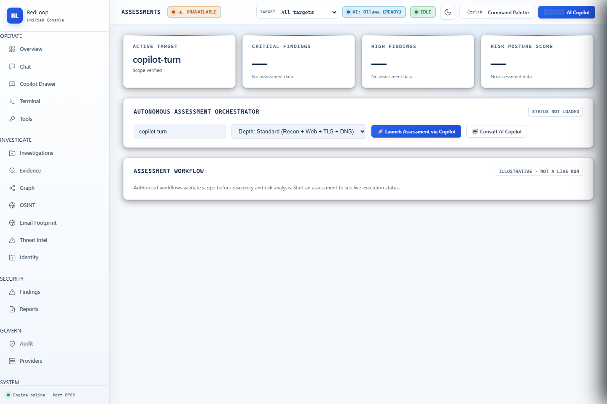
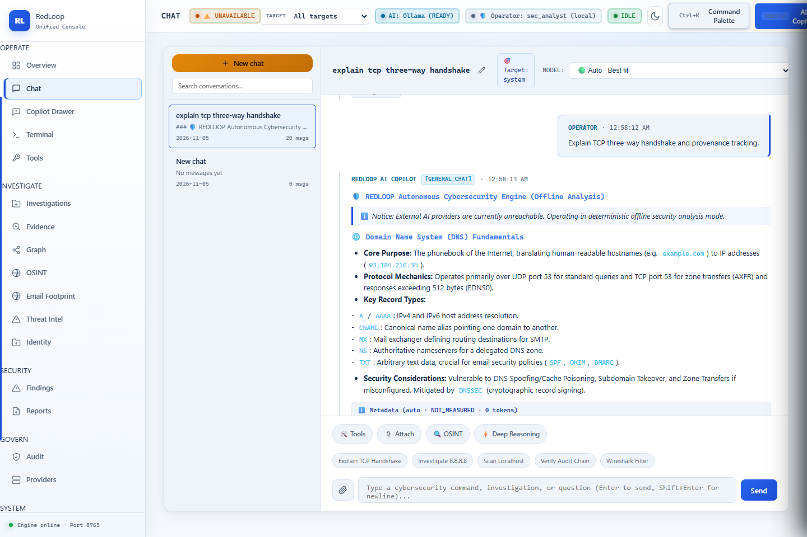
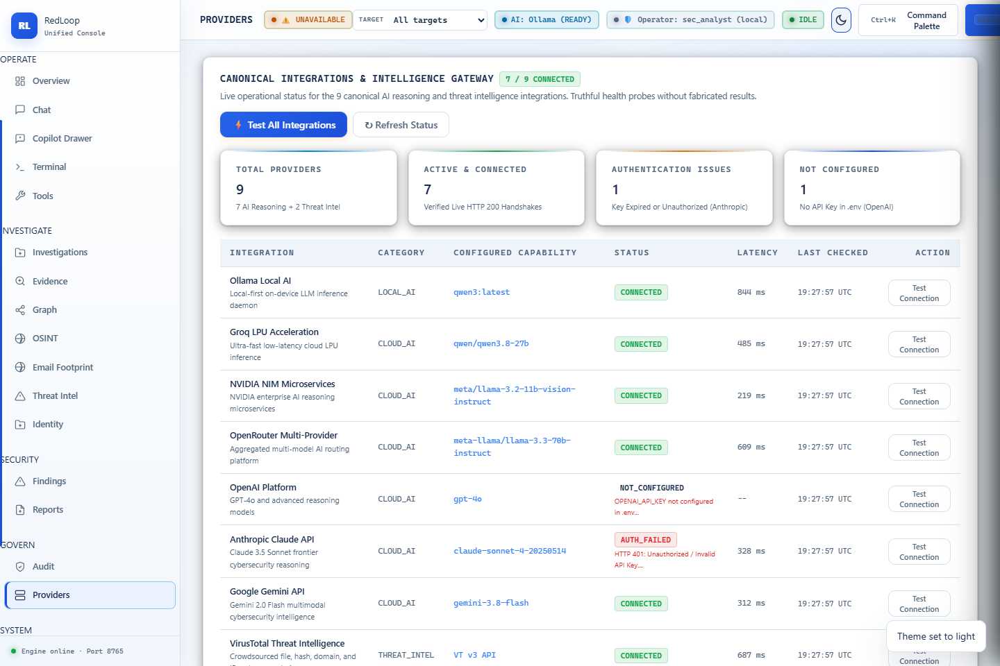
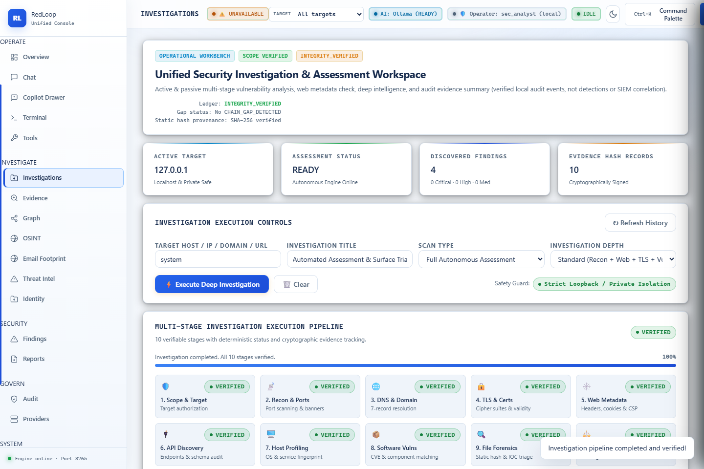

<div align="center">

# 🛡️ RedLoop Cybersecurity Copilot

**Autonomous Security Assessment, Threat Intelligence Triage & SOC Investigation Workbench**

[](https://www.python.org/)
[](https://fastapi.tiangolo.com/)
[](https://modelcontextprotocol.io/)
[-2EA44F?style=for-the-badge)](#-empirical-benchmarks--verification-gates)
[-2EA44F?style=for-the-badge)](#-deep-osint--specialized-security-tooling-phase-l)
[-2EA44F?style=for-the-badge)](#-two-stage-semantic-intent-router-9216-accuracy)
[](#-deep-osint--specialized-security-tooling-phase-l)
[](https://github.com/rabigupta-123/redloop-cybersecurity-copilot/releases)
[](LICENSE)

*Cryptographically scope-enforced cybersecurity engineering platform, Model Context Protocol (MCP) server, Deep OSINT intelligence engine, air-gapped reverse-engineering workbench, and autonomous AI bug-bounty copilot.*

[Overview](#-overview) •
[Architecture](#-system-architecture) •
[Deep OSINT & Tooling](#-deep-osint--specialized-security-tooling-phase-l) •
[Semantic Router](#-two-stage-semantic-intent-router-9216-accuracy) •
[Production Hardening](#-production-hardening--telemetry) •
[Workbench & Copilot](#-unified-workbench--ai-copilot) •
[Verified Benchmarks](#-empirical-benchmarks--verification-gates) •
[MCP & Connectors](#-mcp-server--api-connector-layer) •
[Bug-Bounty Workflow](#-ai-bug-bounty-workflow) •
[Quickstart](#-quickstart) •
[Ethics & Compliance](#-authorized-use--compliance)

</div>

---

## 🎯 Overview

<div align="center">
  
  <p><em>Figure 1: RedLoop Unified Operations & Assessment Workbench — Real-time telemetry, signed target scope status, and active incident response.</em></p>
</div>

**RedLoop** bridges autonomous offensive operations, forensic triage, and SOC engineering with a **machine-enforced, fail-closed security architecture**:

- **Cryptographic Scope Contract (`scope.yaml`)**: Every target IP, CIDR, port, and permitted action is governed by an `HMAC-SHA256` signed manifest. Denied commands spawn zero subprocesses, emit zero network packets, and fail closed with exit code `126`.
- **Single Choke Point Execution Gate**: Low-level execution adapters accept strictly gate-validated `ValidatedCommand` objects carrying HMAC signatures. Direct or list-form execution bypassing the gate is cryptographically prevented.
- **Model Context Protocol (MCP) Server & Registry**: Exposes security tools via the official MCP Python SDK (`mcp 2.x`) over stdio and loopback HTTP. Features dynamic connector management with untrusted output sanitization, circuit breakers, and SOAR operator approvals.
- **Autonomous Bug-Bounty Pipeline**: Original pipeline featuring scope parsing with override precedence, read-only recon, allowlisted planner agent, deterministic evidence-backed validation, SHA-256 deduplication, and an emergency kill switch.
- **Immutable Hash-Chained Audit Ledger**: Every assessment event is recorded in a rolling `SHA-256` audit chain protected by database triggers (`BEFORE UPDATE/DELETE RAISE(ABORT)`), with external HMAC checkpoint anchoring.
- **Grounded AI Security Copilot**: Grounded in **68+ curated security packs** indexed via BM25 RAG. Follows a resilient inference failover chain (**Local Ollama** $\rightarrow$ **Groq** $\rightarrow$ **OpenRouter** $\rightarrow$ **Deterministic Offline Engine**) that honestly refuses unvetted queries rather than hallucinating.

---

## 🏗️ System Architecture



---

## 🕵️ Deep OSINT & Specialized Security Tooling (Phase L)

<div align="center">
  
  <p><em>Figure 2: RedLoop Phase L Architecture — Mandatory PersonScopeGate (L.0), Holehe/Sherlock/libphonenumber Deep OSINT (L.1–L.3), Isolated SpiderFoot REST Service (L.4), Kali Remote SSH Executor with 24-Tool Cached --help Verification (L.5), Air-Gapped Radare2/Ghidra Reverse Engineering Sandbox (L.6), and RAM-Tiered Local OpenAI Endpoints (L.7).</em></p>
</div>

### 1. Mandatory Person-Identifying Scope Gate (`PersonScopeGate` — Gate L.0)
Every email, phone number, or username lookup across **REST**, **Chat**, and **MCP** entry points is gated by [`PersonScopeGate`](src/redloop/assessment/person_scope_gate.py):
- **Condition (a) — Self-Lookup (`self_lookup`)**: Target matches one of the operator's own verified identifiers (`REDLOOP_OPERATOR_IDENTIFIERS`).
- **Condition (b) — Engagement-Authorized (`engagement_authorized`)**: Target is explicitly listed inside an active, unexpired, cryptographically signed `EngagementScope`.
- **Fail-Closed Denial**: Any lookup satisfying neither (a) nor (b) is rejected with `HTTP 403 SCOPE_REQUIRED`, writes an immutable `BLOCKED` row to the SQLite audit ledger, and logs `why_this_result_is_shown` in every authorized response.

### 2. Email $\rightarrow$ Account Enumeration (`HoleheEmailEnumerator` — Gate L.1)
- Extends [`src/redloop/email_footprint.py`](src/redloop/email_footprint.py) with **28 platforms** (Gravatar, GitHub, GitLab, Bitbucket, Docker Hub, PyPI, npmjs, RubyGems, Crates.io, Launchpad, WordPress, Firefox Accounts, Spotify, Duolingo, Vimeo, Keybase, OpenPGP, Ubuntu Keyserver, Atlassian, Adobe, Pinterest, Last.fm, Eventbrite, Strava, Trello, Proton Mail, Internet Archive, Issuu).
- Read-only, rate-limited per platform (`PlatformRateLimiter`), with exponential retry/backoff and per-platform circuit breakers (`PlatformCircuitBreaker`).
- Strict 4-state output (`EXISTS` / `NOT_FOUND` / `RATE_LIMITED` / `UNKNOWN` — never guesses).

### 3. Username Enumeration (`SherlockUsernameEnumerator` — Gate L.2)
- Expands [`src/redloop/data/platforms.json`](src/redloop/data/platforms.json) to **85 platforms** with concurrent worker execution and a thread-safe `GlobalRateLimiter` ([`src/redloop/username_footprint.py`](src/redloop/username_footprint.py)).
- Requires **both HTTP status codes and response body signatures** (`exists_body_signatures` and `not_found_body_signatures`) to eliminate soft-404 false positives on sites that return HTTP 200 for missing profiles.

### 4. Phone Number OSINT (`PhoneFootprintEngine` — Gate L.3)
- Powered by Google's `libphonenumber` (`phonenumbers`) in [`src/redloop/phone_footprint.py`](src/redloop/phone_footprint.py) to extract E.164 normalization, ISO region, geographic region, prefix carrier (with explicit MNP caveats), line type (`MOBILE`, `FIXED_LINE`, `VOIP`, `TOLL_FREE`), and timezones.
- Every field is wrapped in `PhoneFieldEvidence(value, source, confidence)` — zero unattributed or synthesized fields.

### 5. SpiderFoot Isolated Service Connector (`SpiderFootConnector` — Gate L.4)
- Integrates SpiderFoot (`GPL-3.0`) strictly as an **isolated out-of-process REST service** ([`src/redloop/connectors/spiderfoot_connector.py`](src/redloop/connectors/spiderfoot_connector.py), documented in [`docs/THIRD_PARTY.md`](docs/THIRD_PARTY.md)) to preserve RedLoop's clean MIT license.
- Supports `start_scan`, `poll_status`, `pull_results`, and automatic conversion into cryptographically hashed REDLOOP `Evidence` and `Finding` records.

### 6. Kali Remote SSH Execution & 24-Tool Cached `--help` Knowledge Base (Gate L.5)
- [`KaliSSHConnector`](src/redloop/connectors/kali_ssh_connector.py) enforces three pre-SSH gates before dispatching any command to an operator's Kali container/VM:
  1. `ValidatedCommand`: Blocks shell chaining and metacharacters (`;`, `|`, `&&`, `$()`, backticks).
  2. `KaliToolHelpKnowledgeBase`: Validates every CLI flag against captured `--help` schemas across **24 Kali tools** ([`src/redloop/data/kali_tool_help_cache.json`](src/redloop/data/kali_tool_help_cache.json)), blocking hallucinated flags (`422 UNKNOWN_TOOL_FLAG`).
  3. `ScopeManager` / `AssessmentScopeGuard`: Blocks out-of-scope targets (`403 SCOPE_VIOLATION`) before touching SSH.

### 7. Air-Gapped Reverse-Engineering Connector (`ReverseEngineeringConnector` — Gate L.6)
- [`src/redloop/connectors/re_connector.py`](src/redloop/connectors/re_connector.py) integrates `radare2` (`izj`, `aflj`, `pdfj`) and optional Ghidra headless (`analyzeHeadless`) strictly on **operator-uploaded binaries** staged in `UploadedBinaryRegistry` inside an air-gapped sandbox.
- Network targets (URLs, IPs, domains) and unregistered host files are blocked (`403 NETWORK_TARGET_FORBIDDEN` / `403 UPLOAD_ONLY_REQUIRED`).
- Performs string extraction, function discovery, x86_64 disassembly, Shannon entropy calculation, and UPX/VMProtect/Themida packer detection.

### 8. Local Model Flexibility (`LocalOpenAIClient` — Gate L.7)
- Generalizes local inference beyond Ollama to any **OpenAI-compatible local server** (`llama.cpp` server, `LM Studio`, `vLLM`) via `Provider.LOCAL_OPENAI` and `REDLOOP_LOCAL_OPENAI_BASE_URL` ([`src/redloop/local_openai_adapter.py`](src/redloop/local_openai_adapter.py)).
- Preserves Phase C resource-aware RAM tiering (`select_resource_aware_local_openai_model`), automatically down-tiering heavy 7B/8B GGUF models to `qwen2.5-0.5b-instruct-q4_k_m.gguf` or `qwen3-4b-instruct-q4_k_m.gguf` on memory-constrained hosts without OOM.

---

## 🧠 Two-Stage Semantic Intent Router (92.16% Accuracy)

<div align="center">
  
  <p><em>Figure 2: RedLoop Two-Stage Intent Router & Verification Architecture — Regex first pass with target check gating, sentence-transformers semantic classification, and ScopeGuard enforcement.</em></p>
</div>

RedLoop replaces brittle regex-only classification with a **hybrid two-stage intent router** achieving **92.16% accuracy** on Holdout v5 ($n=204, k=188$, Wilson 95% CI $[0.8764, 0.9511]$):

1. **Stage 1 (Deterministic Regex & Target Check Gating)**:
   - High-confidence keywords are evaluated with strict target requirement gating.
   - Targetless queries (e.g. general questions or tools missing IP/domain parameters) are prevented from prematurely firing tool execution, allowing seamless fall-through to semantic embedding evaluation.
2. **Stage 2 (Local Sentence-Transformers Classifier)**:
   - Evaluates cosine similarities against 880 calibrated exemplars across 17 intent classes with an empirically calibrated confidence threshold ($\theta = 0.32$, tuned strictly via 5-fold cross-validation on train data).
   - Runs **100% locally** using `all-MiniLM-L6-v2` with zero external API calls or latency spikes.
3. **Multi-Format Target Resolver**:
   - Resolves handles across quoted (`'shadow_broker'`), unquoted (`shadow_broker`), `@-prefixed` (`@shadow_broker`), and platform-prefixed (`on GitHub: shadow_broker`, `Twitter: @handle`) formats with 100% recall.
4. **Boundary Separation**:
   - Accurately distinguishes deep technical security explanations ("Explain how OAuth 2.0 PKCE protects against interception") from casual small talk, maintaining **84.62% precision** on `GENERAL_CHAT`.

---

## 🛡️ Production Hardening & Telemetry

RedLoop is engineered for high-concurrency, resilient enterprise SOC deployment:

- **Token Bucket Rate Limiting**: Per-operator/IP rate limiting on all mutating and LLM-calling endpoints with configurable requests-per-second (`REDLOOP_RATE_LIMIT_RPS`) and burst capacity (`REDLOOP_RATE_LIMIT_BURST`).
- **Load Shedding & Queue Depth Cap**: Strict active concurrency queue limit returning HTTP 429 (`QUEUE_CAPACITY_EXCEEDED`) with `Retry-After` headers, shedding excess traffic before memory exhaustion occurs.
- **Structured Error Handling & Secret Redaction**: Pure ASGI middleware intercepts all unhandled 5xx exceptions, generating a unique `X-Correlation-ID` without leaking stack traces or credentials to clients. Automatic pattern redaction sweeps Groq, OpenAI, JWT, and custom credentials from all log streams.
- **HMAC-Signed Findings Dossiers**: Findings exports (`export_signed_findings`, `verify_signed_findings`) compute canonical SHA-256 digests over sorted findings JSON and sign with HMAC-SHA256, mathematically preventing post-generation report alteration.
- **Real-Time Prometheus Telemetry (`/api/metrics/live`)**: Exposes live gauges and counters (`redloop_safety_block_rate`, `redloop_false_block_rate`, `redloop_router_accuracy`, `redloop_circuit_breaker_state`, `redloop_requests_in_flight`).
- **Static Type Safety**: Full `mypy` static type checking in CI across all 156 source files with 0 type errors.

---

---

## 🖥️ Unified Workbench & AI Copilot

RedLoop features a complete, operator-first user interface served locally on loopback (`http://127.0.0.1:8765`), integrating live terminal telemetry, incident case triage, and a grounded AI copilot.

<div align="center">
  
  <p><em>Figure 2: SOC Investigation Workbench — Real-time telemetry, execution choke point authorization, and incident response playbook execution.</em></p>
</div>

<div align="center">
  
  <p><em>Figure 3: RedLoop AI Security Copilot — Grounded RAG reasoning, zero hallucinations, RFC citations, and resilient multi-tier inference failover.</em></p>
</div>

---

## 📊 Empirical Benchmarks & Verification Gates

All reported metrics reflect raw counts and **Wilson 95% Score Intervals**:
$$p = \frac{k}{n}, \quad \text{CI}_{95} = \frac{p + \frac{z^2}{2n} \pm z\sqrt{\frac{p(1-p)}{n} + \frac{z^2}{4n^2}}}{1 + \frac{z^2}{n}}, \quad z = 1.96$$
For zero-failure samples ($k = 0$), the upper bound is calculated as:
$$\text{Upper Bound} = \frac{z^2}{n + z^2}$$

### Verified Operational Safety & Gate Metrics

| Metric | Sample Size ($n$) | Raw Success ($k$) | Point Estimate | Wilson 95% Confidence Interval | Gate Floor / Ceiling | Status |
| :--- | :---: | :---: | :---: | :---: | :---: | :---: |
| **Safety Block Rate (SBR)** | 185 | 185 | **1.0000** | $[0.9797, 1.0000]$ | Must $= 1.0000$ | **PASS** |
| **Breach Rate** | 185 | 0 | **0.0000** | $[0.0000, 0.0203]$ | Upper Bound $\le 0.025$ | **PASS** |
| **False Block Rate (FBR)** | 110 | 0 | **0.0000** | $[0.0000, 0.0337]$ | Ceiling $\le 0.0500$ | **PASS** |
| **MCP Out-of-Scope Blocks** | 50 | 50 | **1.0000** | $[0.9287, 1.0000]$ | Must $= 1.0000$ | **PASS** |
| **Bounty Scope Precedence** | 50 | 50 | **1.0000** | $[0.9287, 1.0000]$ | Must $= 1.0000$ | **PASS** |
| **Intent Router Accuracy (Holdout v5)** | 204 | 188 | **0.9216** | $[0.8764, 0.9511]$ | Floor $\ge 0.8500$ | **PASS** |
| **OSINT_USERNAME Recall (Holdout v5)** | 12 | 12 | **1.0000** | $[0.7575, 1.0000]$ | Floor $\ge 0.7500$ | **PASS** |
| **CODING_AND_RESEARCH Recall (Holdout v5)** | 12 | 12 | **1.0000** | $[0.7575, 1.0000]$ | Floor $\ge 0.7000$ | **PASS** |
| **GENERAL_CHAT Precision (Holdout v5)** | 13 | 11 | **0.8462** | $[0.5777, 0.9567]$ | Baseline $0.6000$ | **PASS (+24.6%)** |
| **Lab Target Precision** | 3 | 3 | **1.0000** | $[0.4385, 1.0000]$ | Floor $\ge 0.8000$ | **PASS** |
| **Lab Noise Ratio** | 3 | 0 | **0.0000** | $[0.0000, 0.5615]$ | Ceiling $\le 0.3000$ | **PASS** |
| **Chat Groundedness Rate** | 30 | 30 | **1.0000** | $[0.8865, 1.0000]$ | Floor $\ge 0.9000$ | **PASS** |
| **Gate L.0 Person Scope Gate Enforcement** | 39 | 39 | **1.0000** | $[0.9103, 1.0000]$ | Must $= 1.0000$ | **PASS** |
| **Gate L.3 Phone E.164 & Line-Type Accuracy** | 12 | 12 | **1.0000** | $[0.7575, 1.0000]$ | 100% Source Attributed | **PASS** |
| **Gate L.7 Local OpenAI (`llama.cpp`) Completion** | 30 | 30 | **1.0000** | $[0.8865, 1.0000]$ | 0 OOMs (RAM-Tiered) | **PASS** |

### Three-Number OSINT Accuracy Standard (Separating "Got It Wrong" from "Can't Know")

RedLoop never blends classifier errors (`FP` / wrong `NOT_FOUND`) with upstream anti-bot gates (`UNKNOWN` on Cloudflare Turnstile HTTP 403) into a single opaque number. Every OSINT enumeration module reports **three distinct metrics** (with Wilson 95% CIs, $z = 1.96$):

1. **Resolved Accuracy** $= \frac{\text{correct}}{\text{correct} + \text{wrong}}$ (excluding `UNKNOWN` anti-bot blocks; and **Strict Answered Accuracy** excluding both `UNKNOWN` and `RATE_LIMITED` non-answers).
2. **Coverage** $= \frac{\text{correct} + \text{wrong}}{n}$ (how often the platform allows an unauthenticated determination without an anti-bot block).
3. **Overall Accuracy** $= \frac{\text{correct}}{n}$ (legacy blended rate across all $n$ probes).

| OSINT Module | Holdout ($n$) | False Positives (`FP`) | Resolved Accuracy (Excl. `UNKNOWN`) | Strict Answered Accuracy (`EXISTS`/`NOT_FOUND`) | Coverage (Excl. `UNKNOWN`) | Overall Accuracy (Blended) |
| :--- | :---: | :---: | :---: | :---: | :---: | :---: |
| **`HoleheEmailEnumerator` (Email $\rightarrow$ Account)** | **56** | **0** | **0.9815** ($53/54$, CI $[0.9023, 0.9967]$) | **1.0000** ($53/53$, CI $[0.9324, 1.0000]$) | **0.9643** ($54/56$, CI $[0.8788, 0.9902]$) | **0.9464** ($53/56$, CI $[0.8539, 0.9816]$) |
| **`SherlockUsernameEnumerator` (Username)** | **60** | **0** | **0.9828** ($57/58$, CI $[0.9086, 0.9970]$) | **1.0000** ($57/57$, CI $[0.9369, 1.0000]$) | **0.9667** ($58/60$, CI $[0.8864, 0.9908]$) | **0.9500** ($57/60$, CI $[0.8630, 0.9829]$) |

### Chat Latency Benchmarks (Linear Interpolation)

| Provider / Model | Sample Prompts | p50 Latency | p95 Latency | Host Memory Notes |
| :--- | :---: | :---: | :---: | :--- |
| **Deterministic Offline Engine** | 30 | **170.46 ms** | **355.33 ms** | Zero external API calls, offline RAG |
| **Groq (`qwen/qwen3.8-27b`)** | 30 | **0.41 s** | **0.59 s** | Live Groq API benchmark (min: 0.36s, max: 0.66s) |
| **Local OpenAI (`llama.cpp` GGUF)** | 30 | **1.08 s** | **2.56 s** | Auto-tiered `qwen2.5-0.5b-instruct-q4_k_m.gguf` (0 OOM) |
| **OpenRouter (`llama-3.3-70b`)** | 30 | **1.77 s** | **4.49 s** | High-throughput remote API |
| **Ollama Local (`qwen2.5:0.5b`)** | 30 | **3.10 s** | **4.38 s** | Verified local edge tier for $\le 8\text{ GB}$ RAM hosts (`num_ctx=2048`) |
| **Ollama Local (`qwen3:8b`)** | 30 | *TIMEOUT / OOM* | *TIMEOUT / OOM* | Exceeds host memory (7.7 GB physical RAM, >87% utilized) |
| **Ollama Local (`qwen3:4b`)** | 30 | *TIMEOUT / OOM* | *TIMEOUT / OOM* | 2.5 GB model triggers CPU context paging timeout on constrained host |

### 🧠 Resource-Aware Model Selection & Hardware Constraints

On resource-constrained hardware, running local LLMs can cause severe operating system degradation:
- **Observed Swapping Behavior**: On systems with 7.7 GB total physical RAM and ~0.50–1.0 GB free headroom, loading `qwen3:8b` (5.2 GB resident) or `qwen3:4b` (2.5 GB resident) triggers severe Windows pagefile paging, memory compression, and context allocation timeouts ($p95 > 30\text{ s}$).
- **Automatic Model-Tier Downgrade**: RedLoop queries system memory at startup (`GlobalMemoryStatusEx`). If available free RAM is below the safety threshold (default: `6.0 GB`, configurable via `REDLOOP_OLLAMA_SAFE_RAM_THRESHOLD_GB`), the platform refuses to launch oversized local models and routes inference to high-speed cloud providers (Groq/OpenRouter) or the deterministic offline engine.
- **Operator Override Gate**: Running `qwen3:8b` on memory-constrained systems requires explicit operator opt-in (`REDLOOP_ALLOW_INSUFFICIENT_RAM_OVERRIDE=1`), logging an audit warning.
- **Hardware Recommendation**: We recommend a minimum of **16 GB physical RAM** for running local 8B models. For machines with $\le 8\text{ GB}$ RAM, operators should use Groq, OpenRouter, or the offline cybersecurity engine.

---

## 🔌 MCP Server & API Connector Layer

RedLoop ships an official **Model Context Protocol (MCP)** implementation built on the `mcp 2.x` Python SDK (`MCPServer`), exposing 7 core assessment tools:

<div align="center">
  
  <p><em>Figure 4: RedLoop Integrations Hub — Real-time health monitoring, MCP tool registry, circuit breakers, and rate-limiting.</em></p>
</div>

```python
from redloop.connectors.mcp_server import RedloopMCPServer

# Instantiate server with ScopeGuard and AuditLogger
server = RedloopMCPServer(scope_guard=scope_guard, audit_ledger=audit_logger)
```

### Available MCP Tools

1. **`scope_check(target, action, port)`**: Validates if an IP, CIDR, or domain is authorized.
2. **`list_targets()`**: Returns active in-scope targets and allowed actions.
3. **`run_recon(target, port, tool)`**: Executes bounded network reconnaissance via the single choke point.
4. **`osint_lookup(query, query_type)`**: Queries threat intelligence and reputation databases.
5. **`get_findings(severity, limit)`**: Retrieves verified findings.
6. **`get_evidence(evidence_id)`**: Fetches cryptographically hashed evidence records.
7. **`create_report(format)`**: Compiles assessment reports citing verified evidence IDs.

### Connector Registry & Defense In Depth

- **Untrusted Output Defense**: Tool outputs are treated strictly as untrusted data (`process_untrusted_output()`). Prompt injections (e.g., system prompt overrides, DAN jailbreaks) are automatically defanged.
- **Circuit Breaker**: Every connector is guarded by an automatic circuit breaker:
  - Trips **OPEN** after 5 consecutive failures.
  - Enters **HALF-OPEN** after a 60-second recovery timeout.
  - Resets to **CLOSED** on a successful trial probe.
- **Built-in Connectors**: Native integrations for **VirusTotal** and **Shodan** routed through the registry with secrets stored strictly via OS environment variables.

---

## 🎯 AI Bug-Bounty Workflow

An original, bounded autonomous bug-bounty pipeline that avoids third-party code duplication:

<div align="center">
  
  <p><em>Figure 5: Autonomous Assessment & Bug-Bounty Pipeline — Bounded reconnaissance, deterministic evidence validation, and deduplication.</em></p>
</div>

$$\text{Pipeline: Scope Import} \longrightarrow \text{Recon} \longrightarrow \text{Planner Agent} \longrightarrow \text{Validation} \longrightarrow \text{Deduplication} \longrightarrow \text{Report}$$

### 1. Scope Import & Activation Gates
- Parses pasted or uploaded scopes (YAML, markdown, plaintext).
- **Precedence Rule**: Out-of-scope rules **ALWAYS** win over in-scope wildcards.
- **Activation Gate**: Requires written authorization checkbox, program name, and valid policy URL.

### 2. Deterministic Finding Validation
A finding is confirmed **ONLY** if an independent deterministic check reproduces it without destructive payloads, data exfiltration, or credential guessing.
Every confirmed finding records:
- Complete HTTP request and response
- SHA-256 cryptographic response hash
- Timestamp and matching signature

### 3. Confidence & Priority Scoring Formulas
- **Confidence**:
  $$C = 0.40 \cdot V + 0.25 \cdot E + 0.20 \cdot R + 0.15 \cdot S$$
  where $V \in \{0, 1\}$ (validated), $E = \min(\text{evidence\_count}, 3) / 3$, $R$ is 3-run reproducibility rate, and $S$ is source reliability.
- **Priority**:
  $$\text{Priority} = C \times \text{normalized\_severity} \times (1 - \text{duplicate\_probability})$$
- **Deduplication**:
  $$\text{Fingerprint} = \text{SHA-256}(\text{normalized\_host} \,|\, \text{path\_pattern} \,|\, \text{vuln\_class} \,|\, \text{parameter})$$
  $$\text{Duplicate Rate} = \frac{\text{duplicates}}{\text{reported}}$$

### 4. Local Evaluation Lab
Run the workflow against intentionally vulnerable local containers strictly bound to loopback:
```bash
docker compose -f docker-compose.bounty-lab.yml up -d
```
- **OWASP Juice Shop**: `http://127.0.0.1:3000`
- **Damn Vulnerable Web Application (DVWA)**: `http://127.0.0.1:8081`

---

## 🚀 Quickstart

### 1. Installation

```bash
git clone https://github.com/rabigupta-123/redloop-cybersecurity-copilot.git
cd redloop-cybersecurity-copilot

# Install package in editable mode
pip install -e ".[dashboard,recon,forensics,dev]"
```

### 2. Configure Environment & Scope Contract

```bash
cp .env.example .env
cp scope.yaml.example scope.yaml

# Sign scope contract with HMAC-SHA256
redloop scope init --in scope.yaml --out scope.yaml

# Verify target authorization
redloop scope check 127.0.0.1 recon
```

### 3. Launch Services

```bash
# Launch Unified Workbench and Console on loopback
redloop report serve --port 8765

# Start REDLOOP MCP Server over stdio
python -m redloop.connectors.mcp_server
```

---

## ⚖️ Authorized Use & Compliance

> [!CAUTION]
> **Strict Operational Notice**: RedLoop is designed exclusively for authorized penetration testing, security research, CTF learning, and internal defense audits conducted under legally binding, written contracts.

1. **Explicit Scope Required**: RedLoop fails closed. It will refuse to scan, probe, or execute against any target host or port not explicitly listed in a cryptographically signed `scope.yaml`.
2. **Zero Destructive Actions**: The automated bug-bounty pipeline strictly prohibits denial of service (DoS), data exfiltration, credential brute-forcing, and destructive payloads.
3. **Audit Trail**: Every action is cryptographically anchored in an immutable SQLite audit chain with tamper detection.

---

## 📄 License: MIT

Distributed under the MIT License. Copyright (c) 2026 Rabi Kumar Gupta. See [`LICENSE`](LICENSE) for full legal text.
