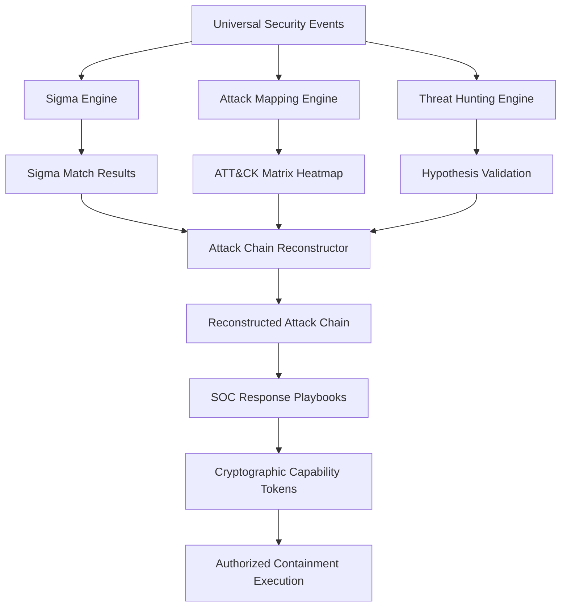

# REDLOOP Phase 6 Architecture: Threat Hunting, MITRE ATT&CK & Detection Engineering

**Author:** REDLOOP Core Engineering Team  
**Version:** 6.0.0  
**Date:** 2026-11-04  
**Status:** Implemented & Verified

---

## 1. System Overview

Phase 6 introduces advanced detection engineering, structured threat hunting, and automated ATT&CK mapping into the REDLOOP Unified Cybersecurity Command Center. The system bridges raw multi-source telemetry ingestion (Phase 5) and autonomous incident triage with high-confidence adversarial behavior modeling.

---

## 2. Component Architecture

### 2.1 MITRE ATT&CK Intelligence (`attack_mapping.py`)
- **Authoritative Catalog:** Versioned local dataset of MITRE Enterprise ATT&CK v15 covering all 14 tactics (TA0001–TA0043) and curated techniques with subtechnique hierarchies.
- **Deterministic Heuristic Mapping:** Translates security events, SOC alerts, and execution commands into technique mappings with explainable confidence ($0.0 \le C \le 1.0$).
- **Heatmap Generation:** Computes tactic-level coverage metrics and high-confidence technique summaries in JSON and executive Markdown formats.

### 2.2 Sigma Detection Engineering (`sigma_engine.py`)
- **Parser & Schema Validator:** Enforces official Sigma v2 specifications using safe YAML parsing (`yaml.safe_load`). Rejects malformed rules and missing condition expressions.
- **Field Modifiers:** Supports `|contains`, `|startswith`, `|endswith`, `|re`, `|all`, and `|base64offset`.
- **ReDoS Protection:** Analyzes regular expression patterns to block catastrophic backtracking vulnerabilities (e.g., nested repetition groups like `(a+)+`).
- **Condition Evaluator:** Evaluates boolean expressions (`and`, `or`, `not`, parentheses) and quantifiers (`1 of selection*`, `all of them`) safely using an abstract shunting-yard evaluator without `eval()`.

### 2.3 Threat Hunting Query Engine (`threat_hunting.py`)
- **Natural Language Parsing:** Converts plain English hunting queries into typed structured queries, automatically extracting IPv4 addresses, hostnames, usernames, process binaries, SHA-256 hashes, and CVE identifiers.
- **Query Plan Preview:** Pre-execution evaluation providing estimated execution cost (LOW, MEDIUM, HIGH), safety checks, and limit clamping (default 100, max 1000).
- **Parameterized Execution:** Safely queries stored events across multi-source telemetry without SQL injection hazards.
- **Hypothesis Lifecycle:** Evaluates hypotheses into `CONFIRMED`, `REFUTED`, or `INCONCLUSIVE` statuses, generating contextual follow-up query suggestions and evidence provenance links.

### 2.4 Attack-Chain Reconstruction Engine (`attack_chain.py`)
- **Canonical Kill-Chain Progression:** Maps correlated events across 13 stages from Reconnaissance to Impact.
- **Evidence Provenance:** Rigorously distinguishes `OBSERVED` steps (direct telemetry evidence) from `INFERRED` steps (heuristic transitions).
- **Telemetry Gap Analysis:** Automatically flags blind spots (e.g., execution observed without initial access perimeter logs, or unobserved lateral movement jumps).
- **Dwell Time & Blast Radius:** Computes total adversary dwell time ($T_{final} - T_{initial}$), identifies initial entry point candidates, and flags crown jewel targets.

---

## 3. REST API Surface

| Endpoint | Method | Purpose |
|:---|:---:|:---|
| `/api/hunting/attack/tactics` | `GET` | List all 14 MITRE Enterprise Tactics |
| `/api/hunting/attack/techniques` | `GET` | List techniques (with optional `?tactic_id=` filter) |
| `/api/hunting/attack/map` | `POST` | Map events or alerts to ATT&CK techniques |
| `/api/hunting/attack/matrix` | `GET` | Generate ATT&CK matrix heatmap (JSON/Markdown) |
| `/api/hunting/sigma/matrix` | `GET` | Return formal Sigma support matrix |
| `/api/hunting/sigma/validate` | `POST` | Validate Sigma rule syntax and schema |
| `/api/hunting/sigma/test` | `POST` | Evaluate Sigma rule against events |
| `/api/hunting/query/plan` | `POST` | Preview execution plan and cost for hunt query |
| `/api/hunting/query/execute` | `POST` | Execute structured hunt and evaluate hypothesis |
| `/api/hunting/chain/reconstruct` | `POST` | Reconstruct unified attack chain from telemetry |
| `/api/soc/playbooks/{id}/execute`| `POST` | Execute containment action under capability token |
